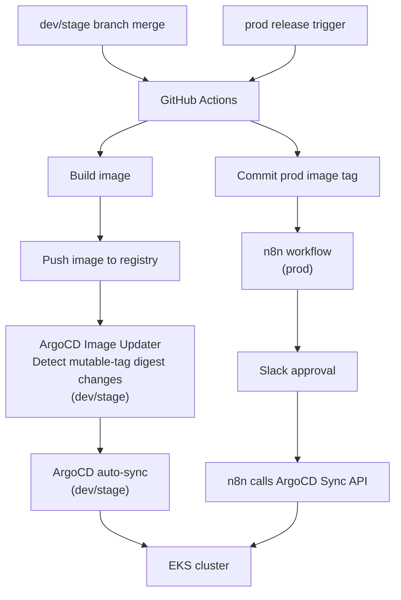
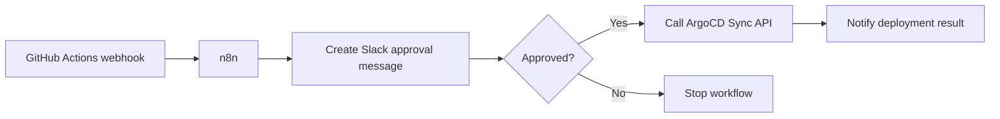

## Background

The service used to run on AWS ECS. The deployment flow was simple: GitHub Actions built a Docker image and directly updated the ECS service. That worked for a while, but several problems appeared as the system grew.

- The CI pipeline had too much authority over production.
- Runtime state was scattered across AWS resources and scripts.
- Rollbacks were not represented clearly in Git.
- Dev, stage, and prod needed different deployment policies.

After moving to EKS, I wanted deployments to follow GitOps. The cluster should converge to the state described in Git, and deployment automation should update Git instead of mutating the cluster directly.

## Overall Architecture



The important distinction is that no deployment tool directly edits Kubernetes production objects. It edits Git, and ArgoCD applies the desired state.

### dev / stage - Fully Automatic

For dev and stage, the goal is fast feedback.

1. GitHub Actions builds the image.
2. The image is pushed to the registry with the mutable `dev` or `stage` tag.
3. ArgoCD Image Updater detects a change in the image digest, even when the tag name stays the same.
4. ArgoCD automatically syncs the application.

There is no manual approval. If something breaks, the environment is not customer-facing and can be fixed quickly.

### prod - Deploy After Slack Approval

Production has a different policy.

1. GitHub Actions builds and pushes the image with an immutable tag.
2. It commits that tag to the prod overlay in the manifest repository.
3. n8n receives release metadata and sends a Slack message with approve/reject buttons.
4. If approved, n8n calls the ArgoCD Sync API.
5. ArgoCD applies the new desired state.

The manifest commit happens before approval, so prod auto-sync stays disabled. The approval happens in Slack, and n8n explicitly starts the sync. Git still records the desired deployment state.

## Core Components

### 1. GitHub Actions - CI Pipeline

GitHub Actions is responsible for build and verification.

```yaml
name: build

on:
  push:
    branches: [main]

jobs:
  build:
    runs-on: ubuntu-latest
    steps:
      - uses: actions/checkout@v4
      - name: Build image
        run: docker build -t app-api:${{ github.sha }} .
      - name: Push image
        run: docker push app-api:${{ github.sha }}
```

The snippet shows the image build and push. In the prod workflow, CI then commits the image tag to the manifest repository and calls the n8n webhook to request approval. It does not directly apply Kubernetes objects.

### 2. ArgoCD - Cluster State Management

ArgoCD watches the Git repository and makes the cluster match it.

In dev and stage, Image Updater detects digest changes under the mutable tags and triggers automatic sync; changing the tag name is not required.

```yaml
apiVersion: argoproj.io/v1alpha1
kind: Application
metadata:
  name: app-api-prod
spec:
  source:
    repoURL: https://github.com/example/platform-manifests
    path: apps/app-api/overlays/prod
  destination:
    server: https://kubernetes.default.svc
    namespace: app-prod
  syncPolicy: {}
```

The prod Application has no automated sync policy. Updating Git does not start a production rollout; n8n calls the Sync API only after Slack approval. Dev and stage use automatic sync instead.

### 3. n8n - Slack Approval Workflow

n8n acts as the glue between CI and Slack.



n8n was useful because the workflow is mostly integration logic: receive metadata, format Slack messages, wait for interaction, call the ArgoCD Sync API, and notify the result.

### 4. kustomize - Environment Separation

Each environment has its own overlay.

```text
apps/app-api/
  base/
  overlays/
    dev/
    stage/
    prod/
```

CI updates the image tag in the prod overlay before requesting approval. The approval workflow then syncs the prod Application. It does not deploy dev or stage.

## Environment Strategy Comparison

| Environment | Deployment trigger | Approval | ArgoCD sync | Rollback |
|-------------|--------------------|----------|-------------|----------|
| dev | merge or image build | none | automatic | re-push previous image (same tag) |
| stage | merge or image build | none | automatic | re-push previous image (same tag) |
| prod | manifest update, then Slack approval | Slack approval | explicit Sync API call after approval | revert Git commit, then sync |

The key is that all environments share the same manifest structure, but not the same policy.

## Things That Went Wrong

### Why I Delayed ArgoCD for prod at First

At first, I planned to bring ArgoCD into production immediately. Rollback problems during deployment showed that dev and stage needed more verification first. I stabilized those environments while building the n8n approval gate, then brought the flow to production more cautiously.

Production kept automatic sync disabled. A manifest commit prepared the change, and Slack approval allowed n8n to start the sync.

### Why stage Became Fully Automatic

Stage was initially approval-based too. But that slowed down verification. Stage should be close to production, but it should still move quickly enough to catch deployment problems before prod.

So stage was changed to automatic deployment. Production remained approval-based.

### Automatic Rollback Caused by readiness probe

Some deployments rolled back even though the application eventually became healthy. The readiness probe was too aggressive for the startup time.

The fix was to align Kubernetes readiness timing with Spring Boot startup behavior:

- use the proper readiness actuator endpoint.
- set enough initial delay.
- keep failure threshold realistic.
- do not route traffic before DB and external dependencies are ready.

## Results

- Deployment state moved from CI scripts to Git.
- Dev and stage became faster through automatic deployment.
- Production deployment kept manual approval without losing GitOps.
- Rollback became a Git operation.
- Slack approval history and Git history together gave a clearer audit trail.

## Closing

GitOps is not just "use ArgoCD." The important question is where the source of truth lives.

If CI directly changes the cluster, the source of truth is split between scripts, cluster state, and the repository. Recording deployment changes in Git and controlling when ArgoCD applies them makes the model easier to reason about.

The final structure was simple: GitHub Actions builds and records the manifest change in Git, n8n handles Slack approval and starts the sync, and ArgoCD applies it.
